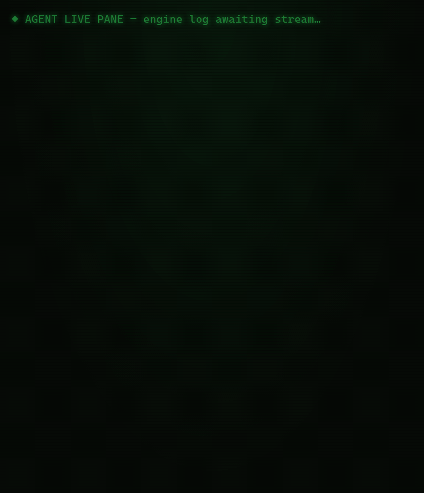

# Agent Live Pane

A Hermes desktop pane that shows the engine, not the chat.

Everything the chat surface hides, in a retro CRT log: reasoning deltas as they
stream, every tool call with the **full arguments it received** and the **full
result it returned**, token usage and context fill per model call, approval and
clarify requests, subagent work, errors, and a raw catch-all so no event type
goes unseen.



## Install

Hermes loads desktop plugins from `<HERMES_HOME>/desktop-plugins/`. Drop the
`plugin.js` in and restart the app:

```bash
mkdir -p "$HOME/.local/share/hermes/desktop-plugins/agent-live-pane"
cp plugin.js "$HOME/.local/share/hermes/desktop-plugins/agent-live-pane/"
```

On Windows the folder is `%LOCALAPPDATA%\hermes\desktop-plugins\agent-live-pane\`.
The pane docks to the left of the workspace area and can be collapsed or widened.
Saving `plugin.js` on disk hot-reloads it in place — no restart needed after the
first install.

## What it shows

| Line | Event | Colour |
| --- | --- | --- |
| `❯ tool  context` | `tool.start`, `tool.complete` with duration, ✓ / ✗ | amber |
| `args: {…}` | the exact JSON the tool was called with, pretty-printed, untruncated | dark amber |
| `result: …` | the exact value the tool returned, untruncated | green |
| italic reasoning | `thinking.delta`, `reasoning.delta`, `reasoning.available` | dim green |
| `[model] prompt … eval … ctx …` | `message.complete` usage, deltas computed against the previous call | cyan |
| `? …` | `approval.request`, `clarify.request`, `secret.request` | yellow |
| `✗ …` | `error` | red |
| anything else | catch-all raw event dump | grey |

## About the demo GIF

The GIF is not a screen recording. It is a scripted event log replayed through
the pane's own line logic in a headless browser, so it is deterministic and
carries no data from the machine it was made on — no keys, no paths, no personal
files can reach it, because nothing live is ever captured.

```bash
python docs/capture_gif.py     # needs playwright + ffmpeg
```

- `docs/demo.html` — the replay page. Edit `EVENTS` to change the story; open it
  in a browser and call `renderAt(ms)` in the console to scrub.
- `docs/capture_gif.py` — steps time at 10 fps, screenshots the pane at 2× device
  pixels, encodes with a 48-colour palette.

Demo content is illustrative, not a captured session.

## Safety

The pane prints tool arguments and results verbatim, which is the point — so it
will also print a secret if a tool call happens to read one (`.env`, `env`, a
config dump). Treat a screen share with this pane visible the same as a terminal
share. Do not add redaction to the pane itself; redaction belongs to the tools.

## Licence

MIT
